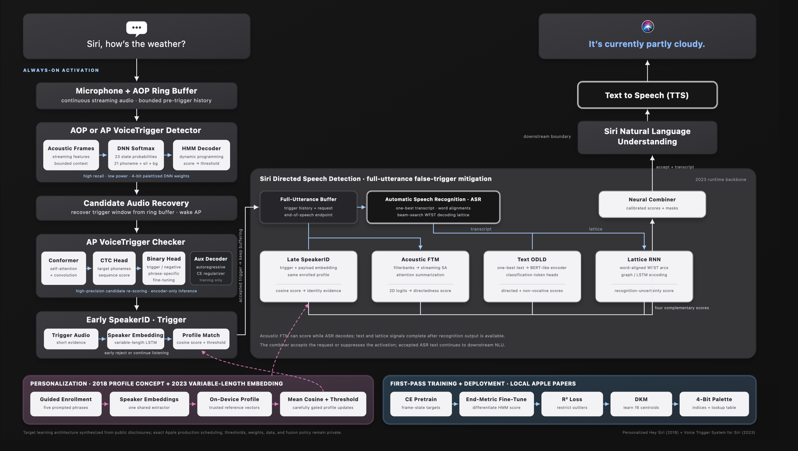

# Siri-Inspired Voice Assistant Architecture

**A notebook-first learning project that reconstructs Apple’s publicly described Siri pipeline—from always-on wake-word detection toward a spoken response.**

`DNN–HMM` · `Conformer` · `SpeakerID` · `Acoustic / Lattice / Text FTM` · `ASR` · `NLU` · `TTS`

> [!CAUTION]
> **Research and education only — not production ready.** The project’s destination is a production-shaped, end-to-end architecture, but each component is learned and tested with small public or synthetic datasets. Current models use isolated words, bootstrap or proxy labels, synthetic continuous streams, and host-side FP32 exports. They have not been validated on representative mobile microphones, natural background hours, spoof/replay attacks, demographic cohorts, or target-device power and latency.

  <a href="#architecture">Architecture</a> ·
  <a href="#dnn-hmm">DNN–HMM</a> ·
  <a href="#conformer">Conformer</a> ·
  <a href="#speaker-id">SpeakerID</a> ·
  <a href="#acoustic-ftm">Acoustic FTM</a> ·
  <a href="#asr">ASR</a> ·
  <a href="#directed-speech">Directed speech</a> ·
  <a href="#nlu-tts">NLU + TTS</a> ·
  <a href="#project-status">Status</a> ·
  <a href="#quick-start">Quick start</a> ·
  <a href="#repository-map">Repository map</a> ·
  <a href="#evaluation-contract">Evaluation</a> ·
  <a href="#limitations-and-roadmap">Roadmap</a> ·
  <a href="#research-basis">Research</a>

---

## Architecture

  

<a href="docs/assets/voice-trigger-pipeline.svg">Editable SVG source</a> · <a href="docs/assets/AppleSiriIcon2017.png">Classic Siri icon asset</a> · <a href="https://twentysixcode.com/">image source</a>

The diagram is the **target architecture**, independent of current implementation progress. It makes one deliberate synthesis from the two supplied Apple documents:

- [*Voice Trigger System for Siri*](apples/machinelearning-apple-com-research-voice-trigger-figure2.md) supplies the 2023 runtime spine: the AOP ring buffer, streaming DNN–HMM detector, AP Conformer checker, early SpeakerID, full-utterance processing, ASR-derived false-trigger signals, Acoustic FTM, text ODLD, Lattice RNN FTM, and directed-speech fusion.
- [*Personalized Hey Siri*](apples/machinelearning-apple-com-research-personalized-hey-siri.md) supplies the 2018 personalization mechanics: explicit enrollment, an on-device speaker profile, cosine scoring, thresholding, and carefully controlled updates from accepted speech.

The merged target uses the newer variable-length speaker embedding family for both trigger-only and trigger-plus-payload decisions while retaining the older paper’s enrollment/profile concept. It does **not** concatenate the 2018 28-state MFCC supervector with the 2023 23-state trigger representation. Those belong to different published generations and remain versioned alternatives.

The first-pass detector also combines three Apple training and deployment techniques without turning them into runtime stages: differentiable HMM end-metric fine-tuning from *Optimize What Matters*, R² range restriction to suppress weight outliers, and DKM clustering to produce the learned 4-bit weight palette. At inference, the AOP/AP still executes one compact streaming DNN–HMM; R² and DKM describe how its weights are prepared.

The architecture spends computation progressively: a small causal model continuously watches microphone frames, and more expensive models run after stronger evidence arrives.

1. **Activate:** a streaming DNN–HMM proposes a trigger, a Conformer checks the phrase, and early SpeakerID tests the enrolled voice.
2. **Recognize:** ASR converts the trigger and request into a transcript, alignments, and a word lattice.
3. **Estimate directedness:** the same enrolled profile scores longer speaker evidence, while Acoustic FTM, a text Out-of-Domain Language Detector, and a Lattice RNN provide complementary evidence.
4. **Combine:** a neural combiner decides whether the utterance was intended for the assistant.
5. **Respond:** accepted speech continues through natural-language understanding and text-to-speech.

The project aims to build a small, auditable learning analogue of each disclosed component with production-oriented interfaces. NLU and TTS complete the repository’s end-to-end learning target, but the two supplied activation papers show them only as downstream continuation and do not specify their internal production design. The repository does not contain Apple code, weights, datasets, private thresholds, or unpublished implementation details. “Clone” here means an independent architectural reconstruction; Apple’s exact current production graph is private and cannot be claimed from public sources.

## Components

### First pass · DNN–HMM

The always-on stage covers raw-data ingestion, profiling, cleaning, speaker-disjoint splitting, signal standardization, augmentation, causal log-Mel features, normalization, bootstrap HMM alignment, DNN training, Viterbi realignment, streaming token passing, hard-negative mining, and a portable FP32 runtime contract.

- **Start:** [DNN–HMM notebook guide](dnn-hmm/README.md)
- **Notebooks:** 16 of 16 implemented
- **Input:** 16 kHz mono PCM
- **Output:** timestamped trigger candidates and bounded decoder state
- **Current evidence:** mechanics of a `stop`-versus-other-word detector on Google Mini Speech Commands

### Second pass · Conformer checker

The checker recovers audio around each first-pass event, profiles candidate and hard-negative coverage, trains a compact multitask Conformer, calibrates a held-out operating threshold, evaluates the two-stage cascade, and exports a verified FP32 PT2 intermediate.

- **Start:** [Conformer notebook guide](conformer/README.md)
- **Notebooks:** 7 of 7 implemented
- **Input:** first-pass candidate windows
- **Output:** trigger or non-trigger decision
- **Current evidence:** held-out development evaluation on candidates derived from the same small source corpus

### Personalization · SpeakerID

The personalization stage freezes enrollment and probe roles, constructs genuine and impostor trials, trains a compact speaker embedding encoder, creates enrollment profiles, calibrates cosine scoring, measures the matched-source three-stage cascade, and exports its deterministic FP32 reference package.

- **Start:** [SpeakerID notebook guide](speaker-id/README.md)
- **Notebooks:** 8 of 8 implemented
- **Input:** accepted trigger audio and an enrolled profile
- **Output:** enrolled-speaker accept or reject decision
- **Current evidence:** one-recording experimental enrollment forced by available data

### Directedness · Acoustic FTM

The directedness stage begins buffering on the shared microphone clock while earlier gates run. Its first notebook verifies bounded full-utterance collection and endpoint state transitions for trailing silence, no-request timeout, and maximum duration.

- **Start:** [Acoustic FTM notebook guide](acoustic-ftm/README.md)
- **Notebooks:** 1 of 7 implemented
- **Input:** trigger history plus post-trigger speech
- **Output:** planned assistant-directed versus incidental-speech score
- **Current evidence:** buffer mechanics on deterministic proxy sessions; no valid directedness-training evidence yet

### Recognition · ASR

The planned recognizer will consume the accepted trigger and request once, then expose three versioned outputs: a best transcript for language models, time alignments for audit and synchronization, and a word lattice for uncertainty-aware false-trigger mitigation. Its data, tokenizer, acoustic model, decoder, streaming state, and evaluation protocol will be developed as ordered notebooks.

- **Status:** planned
- **Input:** trigger plus request audio
- **Output:** transcript, alignments, confidence, and word lattice
- **Learning constraint:** begin with a small public command corpus before scaling vocabulary and acoustic diversity

### Fusion · Siri Directed Speech Detection

This planned subsystem combines four distinct signals rather than treating one classifier as the whole problem:

- **SpeakerID, trigger + payload:** extend the existing trigger verifier with longer text-independent speaker evidence.
- **Acoustic FTM:** estimate directedness from prosody and full-utterance acoustics without depending on a transcript.
- **Out-of-Domain Language Detector:** classify assistant-directed language from the ASR text.
- **Lattice RNN:** reason over competing ASR hypotheses instead of trusting only the one-best transcript.
- **Neural combiner:** fuse calibrated component scores and missing-signal masks into the final directedness decision.

### Response · NLU and TTS

After the directedness decision accepts a request, the planned NLU layer will map the transcript to an intent, entities, or a structured action. The planned TTS layer will turn the resulting response text into audio. These stages complete the learning architecture from microphone input to spoken reply; broad Siri services, private user data, cloud orchestration, and Apple platform integrations remain outside what public research permits this repository to reconstruct exactly.

## Project status

| Stage | Progress | Verified artifact | Honest readiness statement |
| --- | :---: | --- | --- |
| DNN–HMM | **16 / 16** | Portable FP32 package and conformance trace | Reference runtime ready for mobile integration work; target-device validation pending |
| Conformer | **7 / 7** | Verified FP32 PT2 intermediate | Platform lowering, quantization, real background hours, and device benchmarks pending |
| SpeakerID | **8 / 8** | Verified FP32 PT2 reference package | Mobile lowering, replay/spoof evaluation, robust enrollment, and device alignment pending |
| Acoustic FTM | **1 / 7** | Full-utterance buffer and endpoint contract | Proxy-only foundation; natural directedness data and model training remain open |
| SpeakerID, trigger + payload | **Planned** | Extends the existing speaker encoder | Requires natural full-utterance speaker evidence |
| ASR | **Planned** | Transcript, alignment, and lattice contract | Dataset and notebook design not started |
| Text ODLD | **Planned** | Text-directedness score | Depends on ASR text and labeled directedness data |
| Lattice RNN | **Planned** | Lattice-based false-trigger score | Depends on ASR lattice export |
| Neural combiner | **Planned** | Calibrated directedness decision | Depends on frozen component score contracts |
| NLU | **Planned** | Intent and structured action | Begins after the speech front end is connected |
| TTS | **Planned** | Spoken response audio | Final stage of the end-to-end learning path |

There are **32 executed notebooks** in the current workspace. Every implemented stage writes machine-readable QA, lineage, figures, and contracts. The project keeps the final test partition sealed; reported results are development evidence and must not be presented as an unbiased production benchmark.

Each notebook is self-contained and persists its outputs, so stages do not depend on variables left in another kernel. Mathematical Markdown appears immediately before code that implements the corresponding equations.

## Evaluation contract

The repository separates engineering checks from model evidence and production claims:

- **Lineage first:** every derived example points back to its source recording, speaker, split, and transformation.
- **Speaker isolation:** speakers remain disjoint between partitions; augmented children never become independent evaluation evidence.
- **Training-only statistics:** normalization, augmentation, checkpoint fitting, and mining rules are learned from permitted development partitions.
- **Frozen thresholds:** downstream evaluation uses thresholds chosen on separate calibration evidence.
- **Streaming invariants:** causal features, bounded state, arbitrary callback chunking, and offline-versus-streaming parity are checked explicitly.
- **Distinct metrics:** wake-word false accepts, false rejects, speaker impostor accepts, and endpoint latency keep their own denominators.
- **Sealed test:** current reports set `test_evaluated` to `false`; exploratory development results are not relabeled as final test performance.

Machine-readable QA reports live under [`reports/`](reports/). Model packages and manifests are created under `data/processed/baseline_v1/` when the notebooks run.

## Limitations and roadmap

The current baseline is intentionally small. Its keyword is **`stop`**, not “Hey Siri” or another production wake phrase. Mini Speech Commands contains isolated one-second words, lacks verified phonetic boundaries, contains no natural trigger-plus-request conversations, and does not represent months of mobile background audio.

The build order follows dependencies while preserving the full target architecture:

1. Acquire a licensed directedness corpus with natural trigger-plus-request and incidental-speech examples.
2. Freeze group- and speaker-safe Acoustic FTM training, calibration, evaluation, and sealed-test partitions.
3. Train and calibrate the block-streaming acoustic directedness transformer.
4. Evaluate the complete four-stage cascade on natural continuous audio.
5. Build the small-vocabulary streaming ASR and freeze transcript, alignment, and lattice interfaces.
6. Extend SpeakerID from trigger-only audio to trigger-plus-payload evidence.
7. Build the text Out-of-Domain Language Detector and lattice-aware RNN mitigator.
8. Calibrate the neural combiner with explicit missing-branch behavior and cascade-level metrics.
9. Add a small intent/entity NLU experiment and a deterministic action contract.
10. Add TTS to complete the microphone-to-spoken-response learning loop.
11. Add replay/spoof attacks, far-field microphones, reverberation, device playback, multilingual speech, and representative user cohorts.
12. Lower accepted models to a real mobile runtime, then measure latency, memory, sustained power, thermal behavior, and quantized accuracy on device.

Until those steps are complete, the exported packages are reproducible reference implementations rather than deployable wake-word products.

## Research basis

The architectural sequence is grounded in Apple’s public descriptions of its voice-trigger and personalization systems:

- Apple Machine Learning Research, [*Voice Trigger System for Siri*](https://machinelearning.apple.com/research/voice-trigger), 2023.
- Apple Machine Learning Research, [*Personalized Hey Siri*](https://machinelearning.apple.com/research/personalized-hey-siri), 2018.
- Apple Machine Learning Research, [*Hey Siri: An On-device DNN-powered Voice Trigger for Apple’s Personal Assistant*](https://machinelearning.apple.com/research/hey-siri), 2017.

The first-pass training and compression synthesis is traceable to the supplied local papers:

- [*Optimize What Matters: Training DNN-HMM Keyword Spotting Model Using End Metric*](<papers/Shrivastava et al. - 2021 - Optimize what matters Training DNN-HMM Keyword Spotting Model Using End Metric.pdf>)
- [*DKM: Differentiable K-Means Clustering Layer for Neural Network Compression*](<papers/Cho et al. - 2022 - DKM Differentiable K-Means Clustering Layer for Neural Network Compression.pdf>)
- [*R² Loss: Range Restriction Loss for Model Compression and Quantization*](<papers/Kundu et al. - 2024 - R2 Loss Range Restriction Loss for Model Compression and Quantization.pdf>)

Read the repository’s [architecture analysis](learning/01-architecture-analysis.md), [keyword glossary](learning/02-keyword-glossary.md), and [research catalog](learning/03-reading-catalog.md) for distinctions between published facts, explanatory equations, and project-specific design choices.

This project is independent, is not affiliated with or endorsed by Apple, and uses “Siri” only to identify the public research architecture being studied. Apple and Siri are trademarks of Apple Inc.
