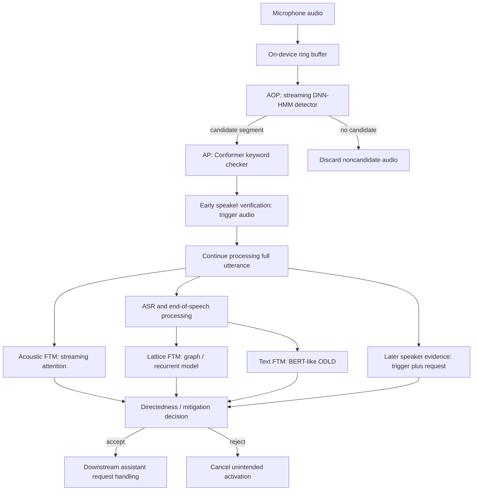

# Deep analysis of Apple’s Siri activation architecture

Research date: 2026-10-16. This analysis reads the two full documents already in `apples/`: [Voice Trigger System for Siri](../apples/machinelearning-apple-com-research-voice-trigger-figure2.md) (11 August 2023) and [Personalized Hey Siri](../apples/machinelearning-apple-com-research-personalized-hey-siri.md) (16 April 2018). The first filename mentions Figure 2, but the file contains the full article.

The central architectural idea is to spend computation progressively as evidence accumulates. A tiny streaming detector proposes candidates; a larger checker verifies the phrase; speaker recognition tests identity; full-utterance models test whether speech addresses Siri. These are distinct classification problems with different inputs, costs and error distributions. The two articles describe activation and personalization, not a complete specification of Siri’s ASR, dialogue, actions, retrieval or speech generation.

Facts below are attributed to the supplied articles. Equations labeled “explanation” or “derived” make the design easier to reason about; they are not undisclosed Apple implementation details. Later research is indexed separately in the [source catalog](03-reading-catalog.md).

## 1. Architecture and responsibility boundaries

This is a conceptual dependency diagram synthesized from the article, not a claim about exact thread scheduling, model fusion or synchronization. The article describes three FTM systems but does not publish a universal fusion equation or establish that every device executes all branches identically. Early acceptance permits further listening/processing; later evidence can still cancel it. [Apple 2023](https://machinelearning.apple.com/research/voice-trigger)

| Stage | Question | Evidence | Main design pressure |
| --- | --- | --- | --- |
| Streaming detector | Might this contain a trigger? | Incremental acoustic frames | High recall under continuous power and memory limits |
| Checker | Was the trigger actually spoken? | Candidate audio segment | Reject confusing phonetic matches |
| SpeakerID | Is this the enrolled speaker? | Trigger initially; longer audio later | Robust identity despite environment and voice changes |
| SDSD / FTM | Was the assistant being addressed? | Acoustics, transcript, recognition alternatives | Suppress incidental mentions and background speech |
| Downstream assistant | What should be done? | Recognized request and context | Outside the two articles’ detailed scope |

Do not collapse wake-word detection, voice activity detection, speech recognition and speaker verification. Speech can be present without a keyword; a keyword can be spoken by the wrong person; the right person can mention Siri without addressing it. Even a correct transcript does not resolve all these questions.

## 2. Document one: Voice Trigger System for Siri (2023)

### 2.1 First pass: why DNN-HMM survives in a neural system

The Always On Processor (AOP) runs a streaming detector. A DNN emits frame-level state probabilities, and an HMM decoder combines evidence across time with dynamic programming. The published output inventory is 23 states: 21 for seven phonemes at three states each, plus silence and background. This is the 2023 detector’s inventory; it is not interchangeable with the 28-state alignment representation in the older personalization article.

The HMM provides an ordered temporal structure. A single frame resembling one sound should not trigger the assistant; the sequence must accumulate support for a phrase. The DNN handles acoustic variability, while decoding handles state progression and duration implicitly through its transitions.

An explanatory max-path recurrence is:

`v_t(s) = acoustic_score(x_t, s) + max_{s'} [v_(t-1)(s') + log a(s',s)]`

Here `a` denotes transition probabilities. This illustrates temporal accumulation only; Apple's complete keyword/background score normalization and decoder configuration are not specified in the article. In particular, a DNN state posterior must not automatically be described as an HMM emission likelihood without considering prior treatment.

### 2.2 Training objective versus deployment objective

Ordinary framewise cross-entropy rewards correct state classification. The user cares about missed invocations and unwanted activations. Those objectives differ: not every state error affects the final trigger decision equally. Apple fine-tunes through a differentiable HMM decoder so that keyword segments receive higher scores and non-keyword segments lower scores.

This is a useful general design principle: improve the training signal before increasing inference complexity. The supporting paper explicitly preserves the inference architecture while changing training. It does not mean discrete false-reject counts become a smooth loss without a score-based formulation. [Optimize What Matters](https://arxiv.org/abs/2011.01151)

### 2.3 Compression: 4-bit weights are one part of the memory budget

Apple reports advanced palettization for 4-bit-per-weight inference, citing DKM and R². Palettization represents weights using indices into a learned set of values; it should not be casually equated with uniform integer quantization. DKM trains weight clusters jointly with the model. R² reduces problematic weight ranges/outliers during training. [DKM](https://machinelearning.apple.com/research/differentiable-k-means), [R²](https://arxiv.org/abs/2303.08253)

Derived storage example: `N` scalar 4-bit indices require approximately `N/2` bytes, plus codebooks and metadata. That is an ideal 8× reduction relative to float32 weight storage. It is not a guarantee of 8× lower peak RAM, power or latency: activations, decoder state, buffers, unpacking and runtime overhead still matter. The article does not give the deployed detector’s complete parameter count or energy profile.

### 2.4 Second pass and Figure 2: Conformer, CTC and auxiliary decoder

The Application Processor (AP) re-scores candidate audio using a larger Conformer encoder. Self-attention models broader temporal relationships; convolution contributes local acoustic structure. The checker can inspect the candidate as a chunk, so this use differs from the continuously streaming first pass.

Figure 2 describes training as well as inference. The encoder has a phonetic CTC objective. An autoregressive transformer decoder adds cross-entropy during training; Apple removes that decoder from inference. The additional supervision regularizes the encoder without imposing autoregressive token generation on the deployed checker.

CTC handles uncertainty about where target phonemes align in time. An explanatory form is:

`L_CTC = -log Σ_(π: B(π)=y) Π_t p(π_t | X)`

`B` collapses repeats and blanks to the target phoneme sequence. CTC is a loss/alignment mechanism, not a synonym for an entire recognizer. A keyword checker with a CTC head is not necessarily a full command transcriber. [Original CTC paper](https://www.cs.toronto.edu/~graves/icml_2006.pdf)

Apple then adds a binary trigger/non-trigger output branch and fine-tunes with phrase-specific discriminative data. This branch is mentioned in the Figure 2 caption but not drawn in that figure. Its published objectives are:

- Positive segment: `L_pos = -max_t log p_t(trigger)`.
- Negative segment: `L_neg = -Σ_t log p_t(nontrigger)`.

The positive objective needs strong evidence somewhere in the candidate. The negative objective suppresses trigger-like evidence across the entire segment. This asymmetry makes sense because one spurious peak can activate a detector. Apple explicitly frames the positive objective for networks that read the whole input; copying it blindly into a causal detector would change its behavior.

A conceptual training objective is `α L_CTC + β L_decoder + γ L_discriminative`, but that compact expression is an explanatory abstraction. Apple describes joint training and subsequent fine-tuning; the article does not specify all weights, schedules, data mixtures or whether all three terms are active in every phase. [Apple 2023](https://machinelearning.apple.com/research/voice-trigger), [Hybrid Transformer/CTC](https://arxiv.org/abs/2008.02323), [Multi-task Voice Trigger Detection](https://arxiv.org/abs/2001.09519)

### 2.5 Speaker recognition: short evidence first, longer evidence later

The 2023 system uses an LSTM-based embedding extractor capable of handling a trigger alone or a trigger followed by a request. Curriculum learning helps learn these variable-length conditions. The article describes two uses: an early speaker decision with trigger audio, and a more reliable later decision using the full utterance.

Training across languages improves robustness and allows a shared speaker model across locales. That does not imply all keyword detectors, pronunciation inventories or ASR models are language-independent. Identity and linguistic content require different invariances.

Apple also adapts ideas from SphereFace2 to reduce the mismatch between multiclass speaker training and binary accept/reject use. This is inspiration from a verification loss framework, not evidence that Apple uses the unmodified face-recognition model or an exact publicly specified loss configuration. [Apple 2023](https://machinelearning.apple.com/research/voice-trigger), [SphereFace2](https://arxiv.org/abs/2108.01513)

### 2.6 Three complementary false-trigger signals

**Lattice FTM:** a one-best transcript hides alternatives. ASR lattices expose competing word hypotheses and their scores. Apple models word-aligned lattices with recurrent/graph methods to classify true versus false triggers. The article explains a graph conversion in which lattice arcs become nodes; this differs from blindly treating original lattice states as the model’s nodes. Uncertainty and query-like structure are informative, but “uncertain” does not logically imply “unintended.” A genuine request in noise can also have competing hypotheses.

**Acoustic FTM:** a streaming transformer consumes filter-bank features, including post-trigger audio. Blockwise attention retains left context without future look-ahead in the described attention design; training masks simulate the streaming constraints. Attention summarization produces a fixed-size representation, followed by a two-class output. Prosody and acoustic conditions provide information that transcription may lose. The example uses three self-attention layers and blocks of `2S` with overlap `S = 32` frames, approximately one second. These are published example settings, not universal constants. No look-ahead does not imply zero latency: chunk accumulation, processing and decision policy still impose delay.

**Text ODLD:** a BERT-like model distinguishes assistant-directed language and non-vocative mentions. Classifier heads use the classification-token representation. “Siri, set a timer” and “I was talking about Siri” can both contain the name while serving different purposes. ODLD is a directedness filter, not the whole task-execution NLU system.

Acoustic independence from ASR reduces one source of correlated error; it does not make the acoustic classifier universally unbiased. All models can fail under mismatched training data. The exact fusion thresholds and per-platform branch selection remain unpublished. [Apple 2023](https://machinelearning.apple.com/research/voice-trigger)

## 3. Document two: Personalized Hey Siri (2018)

### 3.1 Problem definition and enrollment

The article begins with three unwanted cases: the owner says a similar phrase; another person says the keyword; another person says a similar phrase. Speaker verification primarily addresses the latter two identity-related cases, and can also help reject acoustic confusions. It runs after a speaker-independent detector proposes a trigger.

The disclosed system initializes a profile with five explicit enrollment utterances. Accepted subsequent utterances add speaker vectors until the profile contains 40. This is profile accumulation, not evidence that the device retrains the global embedding network for every user. The device also stores corresponding trigger audio so that an updated embedding transform can rebuild the profile.

The tradeoff is adaptation versus contamination. Clean enrollment provides a trustworthy start but weak environmental coverage. Real-world accepted audio improves coverage, yet a false acceptance can pollute the profile. The article identifies this risk; it does not disclose a modern continual-learning policy, replacement scheme beyond the stated cap, or all safeguards. [Apple 2018](https://machinelearning.apple.com/research/personalized-hey-siri)

### 3.2 How variable-length audio becomes a fixed-length vector

The initial representation uses HMM alignment from the trigger detector. Frames belonging to each state are averaged, and state means are concatenated into a supervector. This is a phonetic normalization step: comparable sound positions become comparable vector coordinates despite different utterance durations.

| Disclosed version | Input representation | Transform | Result |
| --- | --- | --- | --- |
| Early linear system | 28 state means × 13 MFCCs = 364 values | LDA | 150-dimensional speaker vector |
| Improved small DNN | 17 nonsilence states × 26 MFCCs = 442 values | 100 sigmoid units, then 100 linear units; speaker softmax for training | 100-dimensional speaker vector |
| Larger DNN | Same 442-value input | Four 256-unit sigmoid layers, then 100 linear units | 100-dimensional speaker vector; 8-bit weights |

The improved front end removes 11 states that largely represent silence and increases cepstral detail. The DNN was trained on roughly 16,000 users with about 150 utterances each. Training predicts speaker identity; inference removes the 16,000-class softmax and uses the linear layer as the embedding.

This distinction explains how enrollment works for a previously unseen person: inference compares embeddings rather than requiring the person to be one of the training classes. More cepstral detail may help distinguish voices, but channel and noise robustness must still be learned. The article’s subsequent work explores noise/reverberation augmentation and recurrent embeddings. [Apple 2018](https://machinelearning.apple.com/research/personalized-hey-siri)

### 3.3 Enrollment matching

For test embedding `e` and enrollment/profile embeddings `r_i`, the described comparison is:

`score(e) = (1/K) Σ_i (e · r_i) / (||e|| ||r_i||)`

Accept when `score(e) > λ`. This is the mean of cosine similarities. Averaging normalized reference vectors and then taking a dot product is algebraically equivalent; renormalizing that average into a unit centroid changes the score scale and should not silently be substituted.

The threshold is an operating-point decision. Raising it normally reduces impostor acceptance at the cost of rejecting more genuine users. Cosine similarity is a score, not automatically a calibrated probability. [Apple 2018](https://machinelearning.apple.com/research/personalized-hey-siri)

### 3.4 What the reported results establish

The article reports speaker-only EER values of 8.0%, 5.3% and 4.3% for the retrained linear, small-DNN and larger-DNN transforms. In its end-to-end evaluation, FR is 9.8%, 5.9% and 5.2%; IA is 11.9%, 3.1% and 3.2%, respectively. The reported false-activation experience changes from about two per month to about one per month for the DNN variants.

The larger model improves EER and FR, but its listed IA is slightly higher than the small model’s at the reported operating points. Therefore, “lower EER improves every deployed metric” is not supported. The article uses separate evaluations: 200 users for the speaker comparison, and 2,800 hours of negative audio plus positive recordings from 150 users for the complete feature. These are historical experimental results, not guarantees for today’s devices or evidence that all demographic/acoustic conditions perform equally. [Apple 2018](https://machinelearning.apple.com/research/personalized-hey-siri)

## 4. What changed between the documents

| Dimension | 2018 disclosure | 2023 disclosure |
| --- | --- | --- |
| Main focus | Personalizing an existing Hey Siri detector | Complete multistage trigger and mitigation pipeline |
| Trigger phrases discussed | Hey Siri | Hey Siri and Siri; platform/locale qualifications apply |
| Speaker representation | State-aligned MFCC supervectors, LDA/DNN transform | Recurrent embedding model for variable-length audio |
| Speaker evidence | Trigger portion | Trigger early; trigger plus request later |
| Speaker training | Multiclass identity classification, then cosine matching | Multilingual data, curriculum learning, verification-oriented loss ideas |
| Compression figures | 8-bit speaker-transform weights | 4-bit first-pass detector weight representation |
| Contextual rejection | Not the main subject | Lattice, acoustic and text-based FTM |

The bit depths refer to different components. Likewise, the older 28-state alignment representation and newer 23-state detector output inventory should not be merged into one architecture. The later article does not reconfirm the 40-vector cap, exact 2018 embedding dimensions or the old cosine threshold policy. Treat those as dated disclosures.

## 5. Evaluation and engineering deductions

These are recommendations derived from the design, not reported Apple implementation details.

**Use distinct denominators.** Keyword FA is typically false activations per hour of negative audio. FR is missed genuine invocations divided by genuine attempts. IA is accepted impostor attempts divided by impostor attempts. EER concerns the operating point where speaker FR and IA match. WER measures transcription errors. None is a substitute for all the others.

**Tune stages together.** For genuine attempts and three hard gates, the chain rule gives `P(pass all | genuine) = P(D | genuine) × P(C | D,genuine) × P(S | D,C,genuine)`. No independence assumption is needed for this conditional form. Multiplying standalone benchmark recall numbers would generally be wrong because downstream inputs have already been selected. As a hypothetical illustration only, three conditional recalls of 0.98 yield about 0.941 overall recall.

**Measure compute on actual traffic.** A useful approximate budget is `average power = always-on power + candidate_rate × energy_per_candidate + accepted_request_rate × downstream_energy`. Define each energy increment without double counting. Even a perfect checker cannot refund the energy spent waking the AP for excessive first-pass candidates.

**Separate early and final outcomes.** Log candidate detections, AP wakeups, provisional user-visible activations, mitigation cancellations and accepted requests. A system can suppress final false responses while still causing too many AP wakeups or visible interruptions.

**Test the hard negatives intentionally.** Include owner/non-owner exact triggers, similar phrases, incidental mentions, television speech, music, overlapping talkers, near/far microphones, reverberation and real conversational pauses. Split by speaker and recording environment to avoid leakage. Test dialects and dysfluent speech; average performance can conceal poor coverage.

**Ablate each extra model.** Compare detector only; detector plus checker; plus speaker verification; then each FTM signal and their combinations. Report FR at matched FA, IA at a declared operating point, latency percentiles, peak memory and measured device power. Use confidence intervals and sufficiently long negative recordings for rare events.

**Manage adaptation as a separate experiment.** Compare frozen enrollment to profile updates, and measure drift under false accepts. Do not infer safe adaptation from a clean speaker-verification benchmark.

## 6. Disclosure limits and citation corrections

The two sources do not provide complete model weights, training corpora, production thresholds, score fusion, AP/AOP runtime implementation, every feature-extraction parameter, absolute energy budgets or exact deployment differences by product. They also do not supply the whole ASR-to-action pipeline. Public papers enable an informed reproduction of ideas, not a bit-for-bit Siri clone.

The supplied 2023 bibliography links *Streaming Transformer for Hardware Efficient Voice Trigger Detection and False Trigger Mitigation* to `2011.01151`, which is actually *Optimize What Matters*. Its correct identifier is [2105.06598](https://arxiv.org/abs/2105.06598); the article’s inline link is correct. The catalog preserves the distinction.

The R² citation uses an earlier title, *Range Regularization for Model Compression and Quantization*. The same [arXiv identifier](https://arxiv.org/abs/2303.08253) now presents *R2 Loss: Range Restriction Loss for Model Compression and Quantization*, with a 2024 revision. This explains the 2024 filename in `papers/` versus the 2023 article reference.

Later Apple publications discuss foundation models and newer speech synthesis. Those sources are cataloged as later context; they do not prove that every 2023 trigger component remains unchanged or has been replaced. [Apple foundation models, 2026](https://machinelearning.apple.com/research/introducing-third-generation-of-apple-foundation-models)
