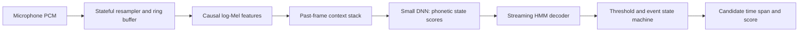

# Experiment 01: streaming first-pass DNN–HMM keyword detector

Status: planning checklist; no model has been trained or benchmarked. Prepared 2026-10-16.

**Objective:** build a small, causal, speaker-independent detector that converts microphone audio into timestamped keyword candidates. It must work on continuous audio, not just classify pre-cut clips. Its output is intended for a future second-pass checker.

The first deliverable is a reproducible desktop streaming baseline, followed by the same pipeline on one phone. This experiment does not include speaker enrollment, Conformer checking, full ASR, or assistant-directedness classification. Another person saying the exact keyword is a positive example for this stage.

## 1. Reference design and experiment boundary

Apple describes frame-state DNN predictions followed by HMM dynamic programming, framewise cross-entropy initialization, and subsequent keyword-score fine-tuning. Its 2023 detector has 23 outputs: 21 phonetic states plus silence and background. It also reports 4-bit weight compression. These are reference facts, not proof that a small reproduction will achieve Apple's production performance. [Apple 2023](https://machinelearning.apple.com/research/voice-trigger)

The historical article provides a useful starting family: small fully connected networks and temporal accumulation using stay/advance transitions. Our baseline uses that family with an explicitly causal front end and chosen dimensions. [Apple 2017](https://machinelearning.apple.com/research/hey-siri)

## 2. Freeze the experiment contract before collecting data

- [ ] Choose exactly one wake phrase and one language/accent scope. Record the pronunciation or accepted variants in `lexicon.txt`.
- [ ] Choose a target phone and foreground/listening-session mode. Record OS version and audio input route.
- [ ] Define whether the dataset includes the phrase alone, phrase plus command, or both. Include both for a realistic assistant detector.
- [ ] Define the candidate event: keyword start/end estimate, detection-emission timestamp, score and configuration version.
- [ ] Set the first-pass candidate-rate budget separately from the eventual user-visible false activation budget. A checker may reject candidates, but each candidate still costs downstream computation.
- [ ] Record initial evaluation targets before selecting a threshold. Suggested exploratory targets: FR ≤ 10% at ≤ 1 false candidate/hour on the declared test conditions. These are our provisional targets, not Apple metrics or production acceptance criteria.
- [ ] Declare the precision of the first baseline as float32. Add compression only after correctness is established.

**Gate:** the phrase, platform, scope and metric denominators are written down. The checklist can proceed without any Apple private dataset or model weights.

## 3. Starter configuration

Every value in this table is a proposed experiment setting, not an exact reconstruction of Apple's deployed model.

| Component | Initial setting | Reason |
| --- | --- | --- |
| Audio | 16 kHz mono after explicit conversion | Simple common speech-processing rate |
| Features | 40 log-Mel bands; 25 ms window; 10 ms hop | Compact acoustic representation |
| Feature timing | Right-aligned windows, no centered padding | Avoid future-audio leakage |
| Normalization | Fixed per-band statistics computed on training audio only | Same operation in training and streaming |
| Input context | Current frame + 19 past frames | 800 input values and no future-frame look-ahead |
| DNN | Five fully connected hidden layers, 32 units each, sigmoid; state output layer | Small historical-style baseline |
| Output | Phonetic-state classes, silence, background | Support ordered decoding rather than a binary clip label |
| Training | Framewise cross-entropy, one fixed seed initially | Establish a debuggable baseline |
| HMM | Left-to-right keyword topology; self-loop and advance transitions | Accumulate the phrase in phonetic order |
| Output policy | Candidate events plus diagnostic frame scores | Inspect false peaks and repeated triggers |

The 20-frame feature stack spans approximately 215 ms of waveform because each frame uses a 25 ms analysis window. It requires past context; it does not add 190 ms of future look-ahead. Startup buffering and computation still have latency. Record the startup policy explicitly.

- [ ] Count actual parameters and multiply-accumulates from the implementation. At 23 outputs this example has 30,615 parameters, approximately 120 KiB of float32 weights/biases, and 3.04 million dense-layer MACs/second at 100 frames/second. Feature extraction, nonlinearities, decoder and runtime costs are additional.
- [ ] Use 23 outputs only if the selected pronunciation/state mapping warrants it. For a custom phrase, derive the vocabulary and graph. Repeated phonemes can share acoustic labels while occupying different graph positions; document that mapping.
- [ ] Specify feature extraction completely: FFT size, window function, Mel scale, frequency limits, log floor and numerical precision. A proposed starting point is a 512-point FFT and 20–7,600 Hz Mel range.

## 4. Build the smallest useful data collection

These quantities are a starting budget for discovering failures, not evidence of production readiness.

- [ ] Collect roughly 30–50 speakers × 20–30 real utterances, if possible. Use different distances, speaking speeds, recording sessions and a mix of phrase-alone/phrase-plus-command recordings.
- [ ] If fewer speakers are available, narrow the claim to that population. Hundreds of augmented copies of one voice do not establish speaker-independent performance.
- [ ] Collect phonetic confusions, phrase fragments, reversed/missing words, and ordinary speech containing individual keyword phonemes.
- [ ] Obtain 20–50 hours of usable continuous negative audio as a starter pool: conversation, media playback, music, environmental noise and silence. Check permitted use and annotate any actual keyword occurrences.
- [ ] Reserve separate continuous-negative validation and test recordings. Increase their duration as the target false-candidate rate becomes stricter.
- [ ] Split by speaker and recording source/session before augmentation. Use approximately 60/20/20 train/validation/test speaker allocation, and report actual counts.
- [ ] Keep test recordings real, untouched and representative of the microphone path.
- [ ] Add training-only noise/reverberation, gain variation and moderate speed changes. Update timing labels after transformations that change duration.
- [ ] Treat TTS as supplementary training data. Do not use synthetic-only evaluation to claim real-world robustness.

**Artifacts:** a manifest with `audio_path`, `speaker_id`, `session_id`, `source_id`, `split`, `transcript`, `keyword_start`, `keyword_end`, `condition`, and collection/provenance metadata. Use null keyword times for true negative recordings.

## 5. Solve phonetic alignment before DNN training

**This is the first modeling task.** A binary label such as “contains the wake phrase” is insufficient for supervised phonetic-state DNN training.

- [ ] Use an offline forced aligner with the correct language model and lexicon to obtain phone boundaries from transcripts. It is a label-generation tool, not part of mobile inference.
- [ ] If no suitable aligner is available, hand-align a small seed set and explicitly budget for iterative alignment refinement. Do not invent phoneme boundaries by splitting the whole utterance equally.
- [ ] For a simple three-state phone bootstrap, divide each aligned phone into beginning/middle/end regions. Mark this as approximate state supervision, not ground-truth HMM state alignment. A compatible HMM aligner's state labels are preferable when available.
- [ ] Inspect at least 50–100 varied examples, including boundaries and low-confidence alignments. Correct or exclude badly aligned training examples.
- [ ] Preserve keyword-relevant phone-state labels when those phones occur in ordinary speech; map other speech appropriately to background. Do not teach that the same /s/ is a keyword phone only inside positive clips and always background elsewhere without intentionally designing that different target scheme.
- [ ] Label actual silence separately from other speech/noise using a documented policy. Audio energy alone is not a reliable speech/noise classifier.
- [ ] Compute label counts, state occupancy and state priors from the training split. Flag missing states and implausibly short segments.
- [ ] Estimate stay/advance transitions from training alignments with smoothing; normalize outgoing transition probabilities and record boundary conventions.

**Gate:** an inspected audio example can be traced from waveform → phone boundaries → state labels → valid HMM path.

## 6. Verify the streaming front end

- [ ] Use the same resampling and feature code for training-data preparation and replay wherever possible.
- [ ] Preserve resampler/filter state and partial frame samples between microphone callbacks.
- [ ] Feed a recording in varying chunk sizes; the resulting feature sequence must agree with the whole-recording causal reference within a declared numerical tolerance.
- [ ] Check the context stack at startup, recording gaps, device-route changes and reset.
- [ ] Avoid utterance-wide normalization, centered spectrogram windows and accidental future-frame context.
- [ ] Test both a keyword crossing a callback boundary and a keyword immediately after silence.
- [ ] Feed finite silences/noises of long duration; verify no NaNs, growing buffers or unbounded state.

**Gate:** arbitrary callback boundaries do not change the detector's acoustic input.

## 7. Train and debug the float32 acoustic model

- [ ] First overfit 10–20 correctly aligned training utterances as a wiring check. This is not an accuracy benchmark.
- [ ] Plot state posterior sequences; confirm progression through the keyword and sensible silence/background behavior.
- [ ] Train the full small model with framewise cross-entropy. Save seed, optimizer, learning-rate schedule, sampling policy and checkpoint metadata.
- [ ] Avoid allowing silence/background volume to dominate every batch. Record any resampling or class weights because they affect posterior calibration and prior treatment.
- [ ] Monitor state confusion and validation loss, but select useful operating points using keyword-event metrics.
- [ ] Keep held-out test audio out of checkpoint selection and false-positive mining.

**Low-data fallback:** if random-initialized training generalizes poorly, retain the DNN–HMM runtime and improve supervision using aligned public speech or offline teacher targets. Document this as a separate experiment. The original small-data run remains the baseline rather than being silently replaced.

## 8. Implement a streaming HMM decoder you can explain

For a keyword state `j`, the basic log-domain recurrence is:

`v_t(j) = e_t(j) + max(v_(t-1)(j) + log a(j,j), v_(t-1)(j-1) + log a(j-1,j))`

This illustrates staying or advancing. A usable detector also needs keyword entry/restart, background competition or a documented confidence normalization, duration handling and event generation.

- [ ] Define acoustic scoring precisely. One conventional hybrid choice is `e_t(j) = log(max(p_t(j), ε)) - log(max(prior(j), ε))`. If using posterior scores directly instead, document that choice and calibrate accordingly; do not mix conventions across runs.
- [ ] Ensure priors and sampling/class weighting are consistent with the chosen score formulation. Prior subtraction is not automatically correct after arbitrary target reweighting.
- [ ] Define the background/silence path and how a keyword can start at any time in continuous audio. A decoder initialized only at file start will fail live use.
- [ ] Choose and document a candidate score: for example a keyword-versus-background log-score difference over the same time interval, with declared duration normalization. Raw accumulated log-probabilities across different lengths are not directly comparable.
- [ ] Track candidate starts and durations. If imposing hard maximum durations, retain enough competing paths or age-indexed state to enforce them correctly; rejecting only an overlong best path can lose a valid shorter alternative.
- [ ] Add an event state machine with threshold, release condition and a documented cooldown. Log unsuppressed peaks too, so cooldown cannot hide an unstable model.
- [ ] Verify legal and illegal state sequences with synthetic posteriors: correct order, missing states, wrong order, sustained background, long held sounds and repeated keywords.
- [ ] Compare small-graph scores against exhaustive path enumeration. Resolve transition initialization, terminal-state and tie-breaking differences.
- [ ] Confirm live-chunk and offline-causal decoder outputs match, including after multiple minutes of audio.

**Gate:** the detector finds a phrase at arbitrary positions without relying on pre-cut clip boundaries.

## 9. Evaluate events and choose a threshold

- [ ] Sweep the threshold on validation audio and plot FR against false candidates/hour. Lock threshold and event policy before opening the test results.
- [ ] Define event matching before evaluation: for example one candidate emitted from keyword start through 500 ms after annotated keyword end. State this tolerance explicitly and report latency separately; a broad matching window must not conceal late detection.
- [ ] Enforce one-to-one matching between detections and reference invocations. Record duplicate detections separately.
- [ ] Calculate `FR = missed reference invocations / all reference invocations`.
- [ ] Calculate `false candidates/hour = unmatched candidate events / negative audio hours`, using clearly specified negative intervals or wholly negative recordings.
- [ ] Report results by quiet/noisy, near/far and speaker group alongside aggregate values.
- [ ] Measure emission latency from the annotated keyword end, including any early detections and the feature/chunk buffering policy.
- [ ] Run real streaming negatives without resets at every short clip. Reset policy is part of the benchmark.
- [ ] Mine errors only from training/development audio. Retrain, then evaluate with the same untouched test protocol.

Zero false candidates over a short recording does not establish a very low rate. As a rough statistical guide under a stationary Poisson assumption, zero events in `T` hours gives a one-sided 95% upper rate bound of approximately `3/T` events/hour. Thus zero over 30 hours supports roughly <0.1/hour under those assumptions, not “never false triggers.” Real environments may violate stationarity.

## 10. Validate on one mobile device

- [ ] Capture audio and run the full front end, DNN, decoder and event policy locally.
- [ ] Keep inference off the real-time audio callback; use bounded queues and detect dropped audio.
- [ ] Confirm recorded-audio replay agrees with desktop output within an explicit tolerance; investigate feature differences before retuning thresholds.
- [ ] Measure processing-time distribution relative to incoming audio duration, dropped frames, peak memory, CPU use and thermal behavior over a sustained session.
- [ ] Measure incremental energy against an audio-capture-only baseline under matched conditions; model file size is not a power measurement.
- [ ] Test permission denial, audio interruptions, sample-rate changes and resume/reset handling.
- [ ] State the actual execution environment. Ordinary mobile app execution is not evidence of running on Apple's Always On Processor.

**Gate:** no growing memory, no audio backlog at the chosen sustained load, reproducible candidate events, and an explicit energy/latency report on the target device.

## 11. Experiment ladder after the first baseline

Change one major factor at a time and retain the same held-out tests.

| Run | Change | Main comparison |
| --- | --- | --- |
| E01-A | Float32 DNN, frame CE, streaming HMM | Correctness and first FR–candidate-rate curve |
| E01-B | Add mined confusions and augmentation | FR at matched false-candidate rate |
| E01-C | Compare 32 versus 64 hidden units | Accuracy gain versus measured compute/memory |
| E01-D | Quantize a stable model, initially INT8 if supported | Accuracy and actual runtime cost versus float32 |
| E02 | Fine-tune through differentiable keyword scoring | Improved detection with unchanged inference architecture |
| E03 | Investigate DKM/R² and lower-bit representation | Measured benefit on the chosen runtime, including decoding overhead |

For E02, read and implement the exact score-based training objective and positive/negative segment construction in [Optimize What Matters](https://arxiv.org/abs/2011.01151). Its contribution is optimization through the decoder while preserving inference cost. It is not simply cross-entropy renamed, nor direct differentiation through a hard threshold. Compare against the established E01 baseline before attributing gains to the new loss.

## 12. Required experiment report

- [ ] Wake phrase, pronunciations, state inventory and graph.
- [ ] Dataset sources, split counts, unique speakers and negative hours per split.
- [ ] Alignment method, inspected examples and rejected-label counts.
- [ ] Feature configuration, training configuration, checkpoint and code/config versions.
- [ ] Decoder scoring convention, transition estimates, duration bounds and event policy.
- [ ] Validation threshold curve and locked test operating point.
- [ ] Test FR, false candidates/hour, duplicates and latency distribution.
- [ ] Phone measurements: compute, RAM, audio drops, sustained energy and thermal behavior.
- [ ] Failure examples and the next single experiment to address them.

**Definition of first-experiment success:** a small DNN–HMM detector runs causally on continuous audio, its labels and decoder are inspectable, its streaming output is reproducible, and its accuracy/resource tradeoff is measured. Passing this experiment establishes a credible baseline, not production equivalence to Siri.
