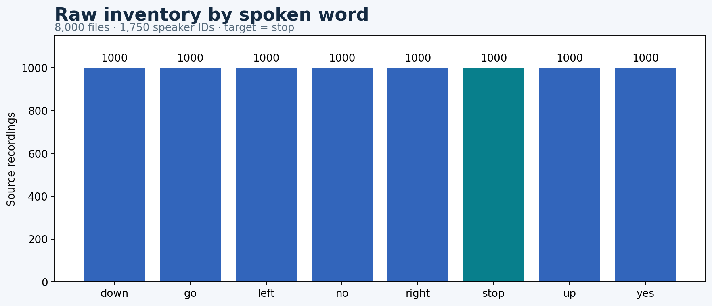
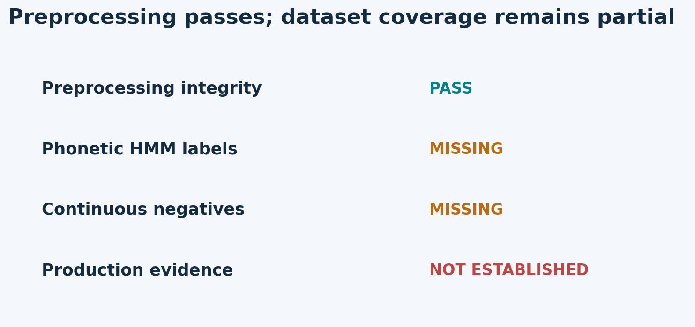

# Preprocessing report · baseline_v1

**Preprocessing QA: PASS.**

Retained 7,973 unique recordings and generated 6,357 training-only variants. Maximum streaming-versus-batch feature error: 1.91e-06.

The data is useful for a `stop` versus other-word mechanics experiment. It is not ready for phonetic DNN–HMM supervision or production evaluation because alignments, continuous negatives, mobile/far-field tests, and manual review are missing.

